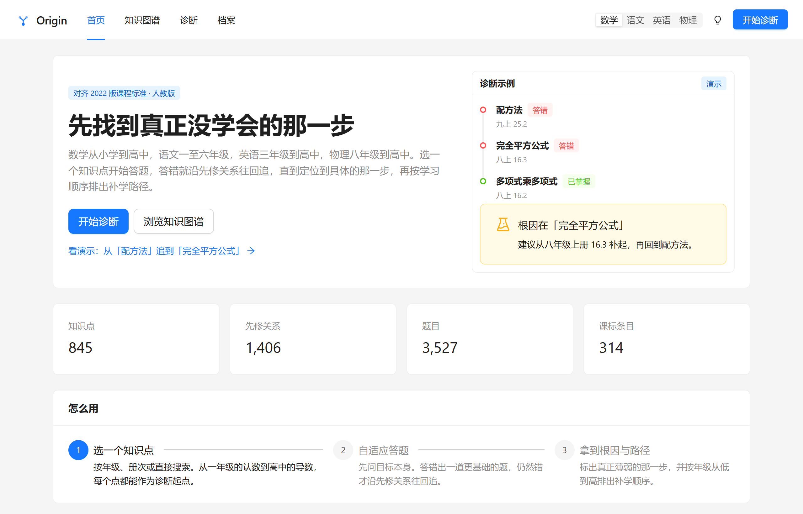
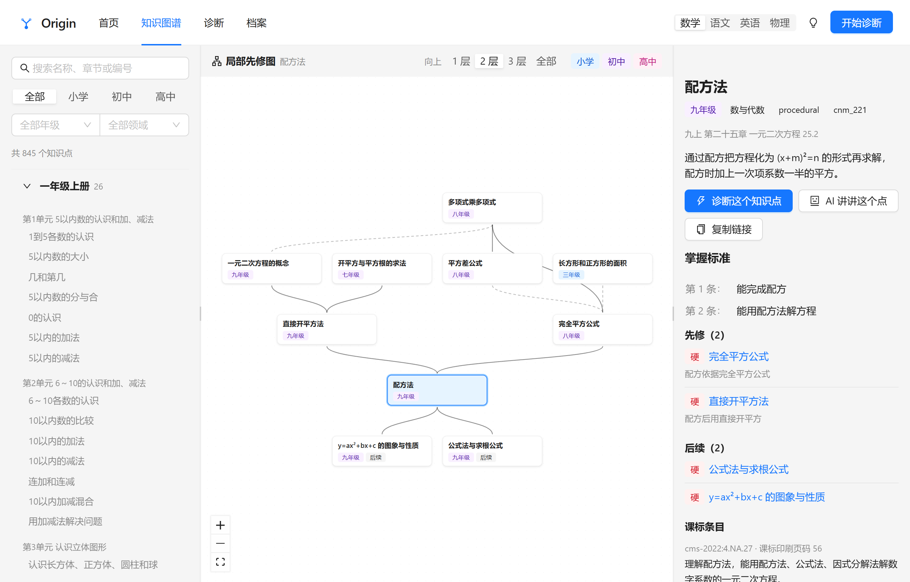
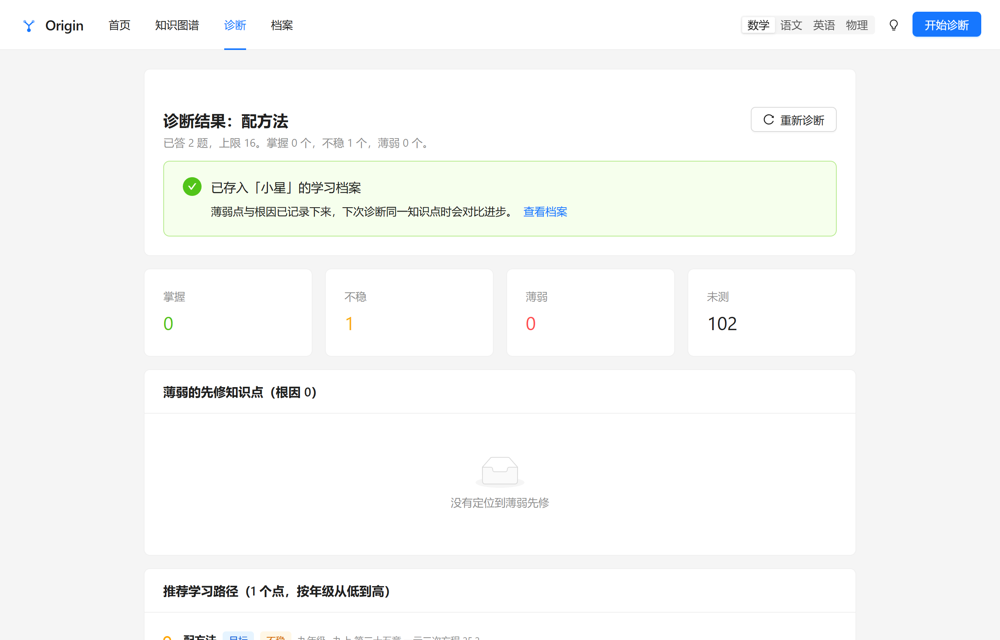
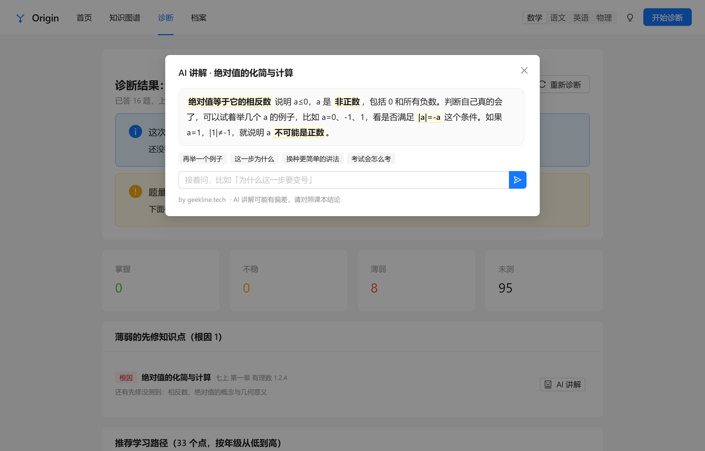
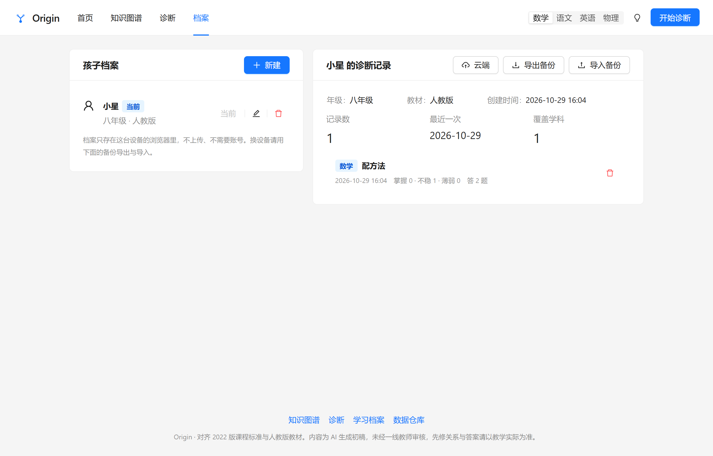
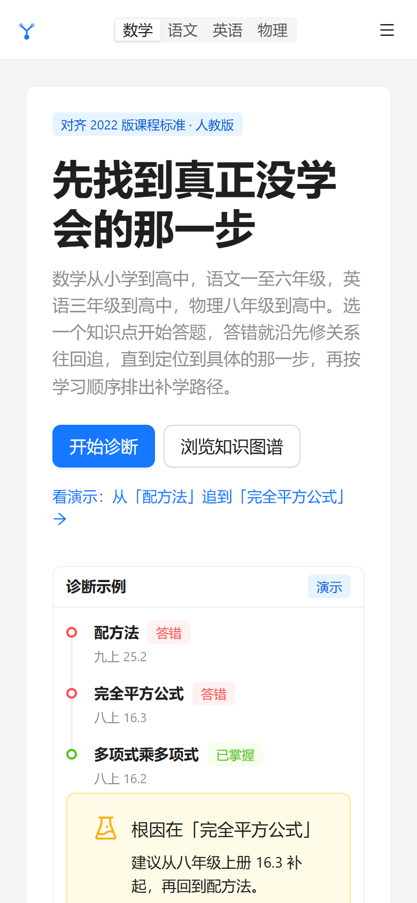
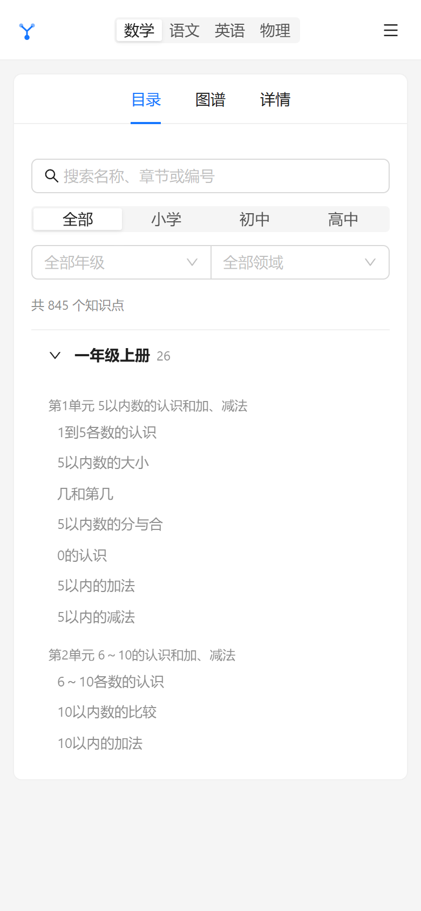

# Origin

中小学知识图谱与自适应诊断。沿先修关系出题，答错就一路往回追，定位到真正没学会的那一步，再按年级顺序排出补学路径。

在线地址：<https://origin.new.tg>

> 本项目 fork 自 [xiaoyang111222/cn-math-taxonomy](https://github.com/xiaoyang111222/cn-math-taxonomy)，在原仓库的知识图谱与诊断引擎之上重做了前端、数据加载与云端能力。

## 它解决什么问题

孩子数学考砸了，家长通常只知道「这章没学好」。但一章里十几个知识点是有先修关系的：不会解一元二次方程，可能卡在配方法；配方法不会，可能卡在完全平方公式；再往下可能是乘法公式。

Origin 把这件事变成可执行的流程：

1. 选一个知识点作为诊断目标（或整册筛查）
2. 系统按先修关系自适应出题，答错先补一道更基础的题确认
3. 确认也错，就沿先修关系继续往回追，直到找到没有更早前置的「根因」
4. 输出根因清单 + 按年级从低到高的学习路径 + 逐章薄弱统计

## 覆盖范围

| 学科 | 知识点 | 先修边 | 题目 | 覆盖学段 |
| --- | ---: | ---: | ---: | --- |
| 数学 | 845 | 1406 | 3527 | 小学一年级 – 高中选必三 |
| 语文 | 652 | 872 | 2290 | 小学一年级 – 八年级 |
| 英语 | 724 | 914 | 2896 | 三年级 – 高中选必四 |
| 物理 | 269 | 637 | 1076 | 八年级 – 高中选必四 |

语文已按统编教材目录逐课收录到八年级上下册，九年级尚未收录（手上的九上电子课本是纯扫描件，需要 OCR 才能提取）。界面上会明确提示缺失学段，不会给出空列表。

## 功能

- **知识图谱**：三栏布局，左侧按册次/章节折叠的知识点列表，中间 React Flow 画的局部先修图，右侧详情（掌握标准、先修原因、课标条目）。窄屏自动切换成「目录 / 图谱 / 详情」标签页。
- **自适应诊断**：三种入口（搜索知识点、按册选择、整册筛查），可配置「连续答对几题算掌握」。结果页给出根因、学习路径、逐章统计与完整答题记录。
- **AI 讲解**：诊断结果、答题反馈、知识点详情三处入口。讲解中用高亮标出关键步骤与易错点，支持多轮追问。不需要登录。
- **学习档案**：本地可建最多 8 个孩子档案、每个 40 条诊断记录，支持导出/导入 JSON 备份与合并导入。登录后可把档案存到云端账号，换设备取回。
- **管理后台**：`/admin`，管理员可看注册账号、云端档案占用、AI 用量趋势与账号列表。

## 界面

首页：直接给出知识图谱规模与三段式诊断流程，点任意一步就能进入对应页面。



知识图谱：左侧按册次折叠的知识点目录，中间是当前知识点的局部先修图，右侧给出掌握标准、先修原因与课标条目。



自适应诊断结果：给出根因清单、按年级从低到高的学习路径，以及掌握 / 不稳 / 薄弱 / 未测的分布。



AI 讲解：关键步骤与易错点用高亮标出，底部提供常见追问，支持多轮对话。



学习档案：本地档案与云端账号打通，登录后可跨设备取回。



移动端：头部收进抽屉，图谱页在窄屏下切换成「目录 / 图谱 / 详情」标签页。

| 首页 | 知识图谱 |
| --- | --- |
|  |  |

## 技术栈

- **前端**：Vite 8 + React 19 + TypeScript 7（`tsc -b` 严格模式）
- **UI**：Ant Design 6（原生视觉，深色模式用 `theme.darkAlgorithm`）
- **图谱**：`@xyflow/react` + `@dagrejs/dagre` 自动分层布局
- **状态**：Zustand（学科选择、登录态，`persist` 到 localStorage）
- **路由**：React Router 7，全部路由 `React.lazy` 拆包
- **后端**：Cloudflare Workers + D1 + Workers AI
- **部署**：Cloudflare Pages（静态）+ Workers（API）

## 目录结构

```
origin/
├── data-src/                  # 手工整理的教材原始条目（初中语文逐课）
├── docs/screenshots/          # README 展示图
├── public/
│   ├── data/                  # 知识图谱与题库（构建时按学科拆分）
│   ├── _headers               # Pages 缓存头
│   └── _redirects             # SPA 回退
├── scripts/
│   ├── build-stats.mjs        # 生成 stats.json 与分科题库
│   ├── build-chinese-junior.mjs  # 把 data-src 的初中语文合并进知识库
│   ├── shots-readme.mjs       # 抓取 README 展示图
│   ├── shot.mjs               # Playwright 截图
│   └── flow-*.mjs             # Playwright 端到端流程验证
├── src/
│   ├── components/            # 站点头部、图谱、AI 讲解、登录弹窗
│   ├── data/core.ts           # 数据加载与图谱构建
│   ├── engine/                # 诊断引擎（原仓库逻辑，改造成 ESM）
│   ├── lib/                   # 主题、学科、档案、账号、API
│   └── routes/                # 首页 / 图谱 / 诊断 / 档案 / 管理
└── worker/
    ├── src/index.ts           # Worker 路由
    ├── src/auth.ts            # PBKDF2 口令散列与会话
    ├── schema.sql             # AI 缓存与用量表
    ├── schema-v2.sql          # 账号、会话、云端档案表
    └── wrangler.jsonc
```

## 本地开发

```bash
npm install
npm run dev          # http://localhost:5173
npm run build        # 生成统计数据 → 类型检查 → 打包
npm run preview      # 预览生产包
```

前端默认请求 `.env` 里的 `VITE_API_BASE`。改成本地 Worker 时：

```bash
# 终端 A
cd worker && npx wrangler dev --port 8787

# 终端 B：把 .env 改成
VITE_API_BASE=http://127.0.0.1:8787
```

不配置 `VITE_API_BASE` 时，AI 讲解与云端账号入口会自动隐藏，其余功能（诊断、图谱、本地档案）完全可用。

## 后端部署

```bash
# 1. 建库并建表
npx wrangler d1 create origin-db
npx wrangler d1 execute origin-db --remote --file worker/schema.sql --config worker/wrangler.jsonc
npx wrangler d1 execute origin-db --remote --file worker/schema-v2.sql --config worker/wrangler.jsonc

# 2. 写入管理员（先改 worker/seed-admin.sql 里的用户名与口令散列）
npx wrangler d1 execute origin-db --remote --file worker/seed-admin.sql --config worker/wrangler.jsonc

# 3. 部署 Worker
npx wrangler deploy --config worker/wrangler.jsonc

# 4. 部署前端
npm run deploy
```

口令散列格式为 `pbkdf2$100000$<salt-base64>$<hash-base64>`，可用下面的片段生成：

```python
import base64, hashlib, os
salt = os.urandom(16)
digest = hashlib.pbkdf2_hmac('sha256', '你的密码'.encode(), salt, 100000, 32)
print(f"pbkdf2$100000${base64.b64encode(salt).decode()}${base64.b64encode(digest).decode()}")
```

## API

| 方法 | 路径 | 说明 |
| --- | --- | --- |
| GET | `/api/health` | 健康检查，返回 D1 状态与当前模型 |
| POST | `/api/ai/explain` | 错题/知识点讲解，支持 `history` + `question` 多轮追问 |
| POST | `/api/auth/register` | 注册，返回会话 token |
| POST | `/api/auth/login` | 登录 |
| POST | `/api/auth/logout` | 注销当前 token |
| GET | `/api/auth/me` | 当前账号 |
| GET / PUT | `/api/archive` | 读取 / 保存当前账号的云端档案 |
| GET | `/api/admin/overview` | 管理概览（用户数、档案占用、AI 用量趋势） |
| GET | `/api/admin/users` | 账号列表 |
| DELETE | `/api/admin/users/:id` | 删除账号及其档案 |

AI 讲解不需要登录，也不限次，只在 D1 里按天计数供后台查看。模型使用 `@cf/meta/llama-4-scout-17b-16e-instruct`，失败时回退到 `@cf/qwen/qwen2.5-coder-32b-instruct`；相同首轮问题按 prompt 哈希缓存，重复提问不消耗额度。

## 数据格式

知识点（`public/data/topics.json`）：

```json
{
  "id": "cnm_221",
  "name": "配方法",
  "domain": "方程与不等式",
  "grade": 9,
  "semester": "上",
  "chapter": "九年级上册 第21章 一元二次方程",
  "type": "procedural",
  "description": "把一元二次方程化为 (x+m)²=n 的形式求解。",
  "mastery_criteria": ["能正确配方", "能处理二次项系数不为 1 的情况"],
  "diagnostic_question": { "question": "...", "answer": "..." },
  "external": false,
  "subject": "math",
  "standards": [{ "id": "cms-2022:...", "confidence": "inferred" }]
}
```

先修边（`dependencies.json`）为 `{ topicId, prerequisiteId, strength: "hard" | "soft", reason }`；题库（`questions.json`）为 `{ id, topicId, difficulty, type, prompt, answer, explanation, choices?, figure? }`。

`npm run data` 会读取这些文件，生成 `stats.json`（首页统计，8 KB）和按学科拆分的 `questions-<subject>.json`，避免首屏加载 4.5 MB 题库。

## 说明

题库解析与知识点描述为 AI 生成初稿，未经一线教师逐条审校；先修关系与答案请以教学实际为准。AI 讲解同样可能有偏差，界面中已标注提醒。
